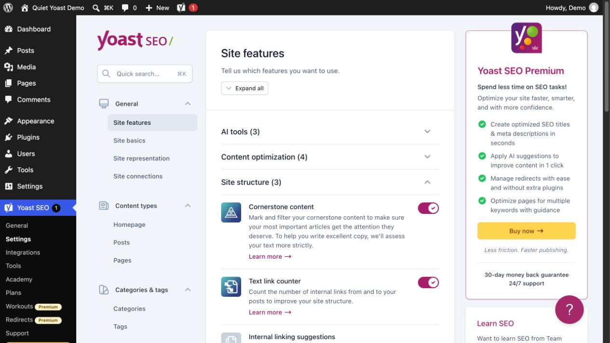
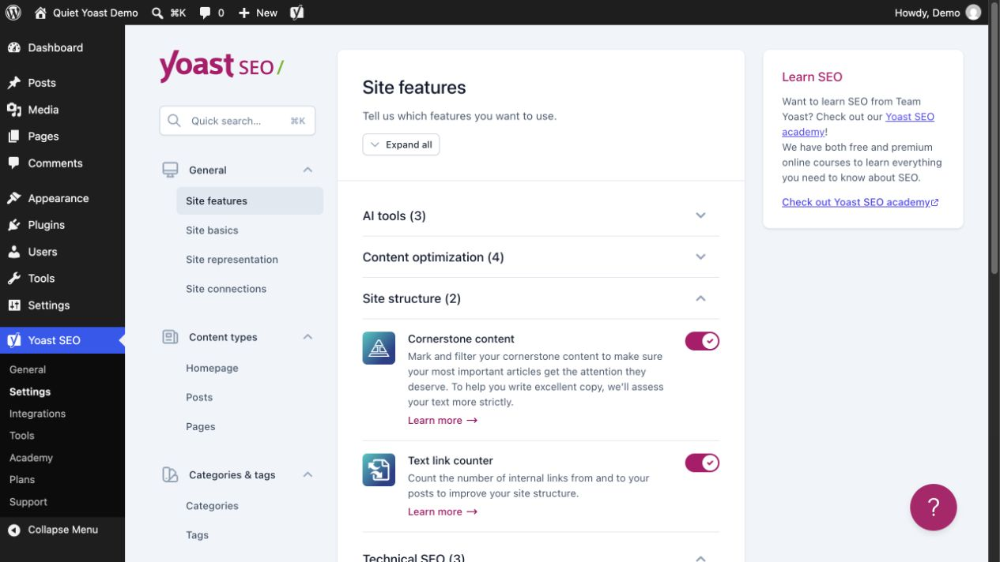

<div align="center">

<h1>Quiet Yoast</h1>

<p><strong>Hide Premium promotions in Yoast SEO Free.</strong></p>

<p>Clean up the interface and exclude hidden promotional items from the displayed counts.</p>

<p>
  <a href="https://github.com/rktsky/wpplugin.quiet-yoast/releases/download/v1.1.1/rktsky-quiet-yoast-1.1.1.zip" target="_blank" rel="noopener noreferrer"><strong>↓ Download plugin · v1.1.1</strong></a>
  &nbsp; · &nbsp;
  <a href="https://github.com/rktsky/wpplugin.quiet-yoast/releases/tag/v1.1.1" target="_blank" rel="noopener noreferrer">View release</a>
</p>

<p><sub>A WordPress plugin by Rocketsky · GPL-2.0-or-later</sub></p>

</div>

---

<a name="vorher--nachher"></a>

## Before / After

<table>
  <tr>
    <th width="50%">Without Quiet Yoast</th>
    <th width="50%">With Quiet Yoast</th>
  </tr>
  <tr>
    <td><a href="docs/screenshots/settings-before.jpg"></a></td>
    <td><a href="docs/screenshots/settings-after.jpg"></a></td>
  </tr>
</table>

Both screenshots show the same test installation, with the same sections expanded and the same window size. Quiet Yoast is disabled on the left and enabled on the right. “Site structure” then counts the two available features. The free feature switches remain available. Click an image to view it at full resolution.

## Installation

1. Activate the free version of **Yoast SEO**.
2. Download **`rktsky-quiet-yoast-1.1.1.zip`** using the link above.
3. In WordPress, go to **Plugins → Add New Plugin → Upload Plugin** and install the ZIP file.
4. Activate **Rocketsky – Quiet Yoast** and reload any open admin pages.

There is no settings page. To update, upload the new installation ZIP and replace the existing version. The automatically generated source archives in the release are intended for development.

## What changes

| Area | Effect |
| --- | --- |
| Navigation | Removes promotional entries from the Yoast menu, tools list, admin bar, and plugin list. |
| Settings and editor | Hides Premium cards, locked feature teasers, and Premium AI buttons. |
| Task list | Hides the Premium promotional footer row while preserving real tasks and their native progress counts. |
| Counts | Excludes promotional rows that are actually hidden, including after recalculation and when sections are expanded or collapsed. |
| Social preview | Hides the locked Premium preview while keeping the available image, title, and description fields usable. |

Actual SEO and readability assessments remain unchanged. Support, the Academy’s free resources, and account and licence information remain accessible.

## A standalone extension

Quiet Yoast leaves WordPress, Yoast, and other third-party files unchanged. It uses WordPress hooks and its own CSS and JavaScript files. It stores no settings and makes no external requests of its own. CSS and JavaScript load only on the relevant admin screens.

Deactivate the plugin and reload to restore the original interface. Cleanup does not run when Yoast SEO Premium is active.

<details>
<summary><strong>Requirements, testing, and limitations</strong></summary>

The plugin requires WordPress 6.5 or later and PHP 7.4 or later. Your Yoast version’s system requirements also apply; Yoast SEO 28.8 requires WordPress 7.0 or later. The CSS rules require a modern browser.

Tested with **WordPress 7.1.4, Yoast SEO Free 28.8, and PHP 8.3.36**. Locally, 53 WordPress integration checks, 43 DOM checks, and 5 PHP and guard checks pass. The interface was also checked in the Classic Editor and block editor, including narrow layouts. The task-list fix was checked with native tasks, progress, a task dialog, route changes, and a narrow viewport. See <a href="https://github.com/rktsky/wpplugin.quiet-yoast/actions" target="_blank" rel="noopener noreferrer">Actions</a> for the latest GitHub runs.

Yoast does not provide a single switch for all Premium promotions. The CSS rules and count adjustments therefore depend on the tested interface structure. Yoast updates may require adjustments. Unrecognised structures keep their original counts. An initially collapsed section is corrected only once its rows can be inspected.

The full [verification report](docs/verification.txt) also lists platforms and extensions that have not been tested. The [interfaces and UI contracts](docs/interfaces.txt) are documented separately.

</details>

## Development

The installed WordPress plugin does not require Node.js or npm. Use Node.js 24 for the isolated development checks:

```sh
npm ci --ignore-scripts --no-audit --no-fund
npm test
```

[Test setup and maintenance](tests/README.md) · [Repository and release package](docs/repository.txt) · [Licence](LICENSE.txt)
